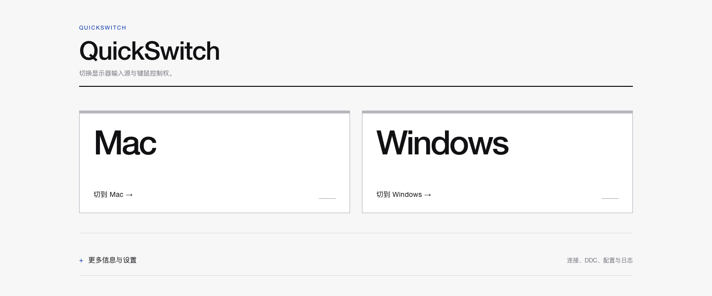
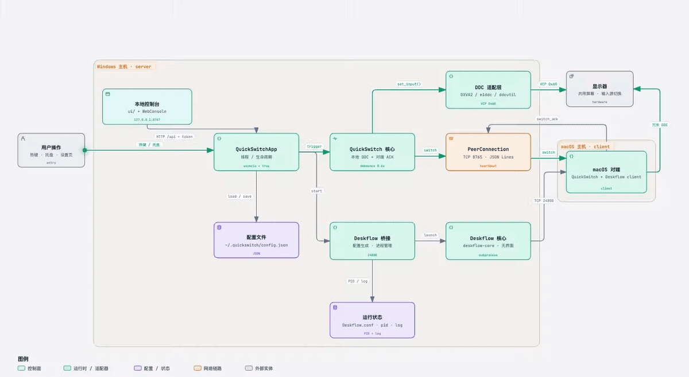

# QuickSwitch

[](https://github.com/Jasonlya/quickswitch/releases/latest)
[](LICENSE)

一键切换**显示器输入源**和**键鼠控制权**，并在两台电脑之间双向共享**剪贴板**（文本、HTML、图片）。Windows 与 Mac 共用一台显示器，按 `Ctrl+Alt+1` 切到 Mac，按 `Ctrl+Alt+2` 切回 Windows；组合键可以自行录制。

> ⭐ **如果 QuickSwitch 帮到了你，欢迎点个 [Star](https://github.com/Jasonlya/quickswitch)。** 这是对项目最直接的支持，也能帮助更多需要双机切换的人发现它。



## 下载安装

**不需要 Python、pip，也不需要手动安装运行库。** 到 [Releases](https://github.com/Jasonlya/quickswitch/releases/latest) 下载对应安装包：

| 你的电脑 | 下载文件 | 安装方法 |
| --- | --- | --- |
| Mac（Apple 芯片 M1/M2/M3/M4） | `QuickSwitch-*-macOS-arm64.dmg` | 打开 DMG，把 QuickSwitch 拖进「应用程序」 |
| Windows 10/11 64 位 | `QuickSwitch-Setup-*.exe` | 双击安装，按提示下一步即可 |

macOS 版只支持 Apple Silicon，不提供 Intel Mac 安装包。安装包已经自带 Python 运行时、托盘依赖和原生设置窗口，目标电脑不需要开发环境。

**键鼠共享核心也已内置。** QuickSwitch 会以无界面方式自动启动随包的 Deskflow 核心；Windows 和 macOS 都不需要安装、配置或打开 Deskflow 客户端。

> **当前安装包未签名。** macOS 首次打开若提示「无法验证开发者」，请右键 QuickSwitch →「打开」→ 再点「打开」；Windows 首次运行若出现 SmartScreen，请点「更多信息」→「仍要运行」。

## 使用前准备

QuickSwitch 负责切换显示器输入源，并直接管理内置的键鼠共享核心：

| 需要准备 | 作用 | 在哪里获取 |
| --- | --- | --- |
| 键鼠共享核心（已内置） | 让一套键鼠控制两台电脑 | 无需单独下载或打开客户端；安装包包含 Deskflow 1.27.0 无界面核心 |
| 显示器 DDC/CI | 允许电脑切换显示器的输入源 | 按显示器机身按钮打开 OSD 菜单，在「系统 / 设置 / 其他设置」里找 DDC/CI；多数型号默认开启，详细路径见 [INSTALL.md](INSTALL.md#11-开启显示器-ddcci) |

键鼠接在 Windows 上时，QuickSwitch 会自动让 Windows 作为服务端、Mac 作为客户端；屏幕左右位置、连接地址、端口和切换热键都由 QuickSwitch 生成并同步给它管理的核心。

Windows 端已内置原生 DDC（DXVA2），**不需要安装 ControlMyMonitor**。macOS 端需要 Apple Silicon，并安装 [m1ddc](https://github.com/waydabber/m1ddc)；如果 Mac 端提示找不到 DDC 工具，按安装文档确认 `ddc.m1ddc_path`。

## 首次配置

1. 两台电脑都安装并启动 QuickSwitch。首次启动会自动弹出**配置向导**。
2. **连接**：推荐选「自动发现」；需要手动填 IP 时，把另一台电脑向导左侧显示的「本机 IP」填进来。
3. **安全**：点「生成」得到 6 位配对码，复制或手动输入到另一台电脑。两端配对码必须完全一致。
4. **显示器**：点「读取」确认当前输入源，再标记为 Mac 或 Windows；也可以直接填写已知数值，或点「探测」让程序试探。
5. **完成**：检查摘要后点「完成配置」。关闭设置窗口，从菜单栏/托盘菜单退出 QuickSwitch，再重新打开，让连接配置生效。

向导只在首次配置时自动出现。以后要修改，展开「更多信息与设置」→「配置」，点「重新运行配置向导」。

macOS 首次使用键鼠共享时，需要在「系统设置 → 隐私与安全性」中允许 QuickSwitch（权限列表里也可能显示 Deskflow 或 deskflow-core）使用**辅助功能**、**输入监控**和**本地网络**。如果核心因为缺少权限退出，QuickSwitch 会自动打开一次辅助功能设置页；键鼠共享状态也会显示「需要权限」。授权后展开「更多信息与设置 → 键鼠共享」，点「重启键鼠共享」即可。设置页还提供「打开辅助功能设置」和「打开输入监控设置」两个按钮。

> `v2.0.4` 及更早版本升级后，如果开关已经打开仍提示「需要权限」，这是 Ad-hoc 签名绑定的旧 cdhash 失效。升级到 `v2.0.5` 后点设置页「重建 macOS 授权」，再重新打开两个开关即可；后续版本不会重复出现。

## 日常使用

- 按 `Ctrl+Alt+1`：切到 Mac；按 `Ctrl+Alt+2`：切回 Windows。可在「更多信息与设置 → 配置 → 热键」点「录入」重新录制，Esc 取消，点「默认」恢复。
- QuickSwitch 启动时会自动启动内置键鼠共享核心；退出 QuickSwitch 时会一并停止它。
- 键鼠共享连接后，任一端复制的文本、HTML 或图片可在另一端直接粘贴。设置页可开关剪贴板共享，并调整单次内容上限（默认 16 MB）。
- 主界面两个切换按钮下方会显示「键鼠共享 · 已连接 / 等待连接 / 连接异常」；点它可直接展开键鼠共享详情。连接成功表示两端核心已经建立 TCP 连接，失败时会显示可读原因。
- 主界面的两个切换按钮右侧会直接显示对应热键；在 Mac 上会标注「Windows 键盘」，因为热键由连接键鼠的 Windows 服务端注册，macOS 本机不注册。
- 切换热键会自动写入键鼠共享配置，一次按键同时切换显示器和键鼠，不需要再去 Deskflow 里重复设置。
- 也可以右键菜单栏/托盘图标，选择「切到 Mac」或「切到 Windows」。
- 设置窗口是应用内原生弹窗，不占用浏览器标签页；主界面只保留两个切换按钮。把鼠标停在按钮上，可查看当前输入源、对端连接、密钥校验、DDC 和快捷键摘要。
- 需要读取/探测输入源、检查连接、修改配置或查看日志时，点「更多信息与设置」展开完整面板。

## 常见问题

| 现象 | 处理 |
| --- | --- |
| macOS 提示「无法验证开发者」 | 右键 App →「打开」→「打开」；或到「系统设置 → 隐私与安全性」点「仍要打开」 |
| macOS 双击无反应或启动卡住 | 先退出 QuickSwitch，再在终端执行 `/System/Library/Frameworks/CoreServices.framework/Frameworks/LaunchServices.framework/Support/lsregister -f /Applications/QuickSwitch.app`，然后重新打开 |
| Windows 提示 SmartScreen | 点「更多信息」→「仍要运行」 |
| 对端一直显示未连接 | 确认两台电脑在同一局域网；Windows 防火墙已放行 TCP `8765` 和自动发现用的 UDP `8766`；macOS 允许 QuickSwitch 访问本地网络 |
| 点切换没有反应 / 找不到 DDC/CI | 按显示器机身的按钮或摇杆打开 OSD 菜单（不是 Windows 显示设置），在「系统 / 设置 / 其他设置 / OSD 设置 / 管理」里找「DDC/CI」（也可能叫 DDC/CI Support、Monitor Control、MCCS 或 Display Data Channel），设为「开 / On」，保存后等 5 秒再试。仍无效时改用直连视频线，绕开 KVM、扩展坞或切换器 |
| Windows 提示找不到 `ControlMyMonitor.exe` | 旧版安装包的回退路径。最新版使用 Windows 内置 DXVA2，不需要该文件；升级后重试，ControlMyMonitor 仅作为可选回退 |
| Windows 设置窗口字体模糊 | 升级到 `v1.0.2` 或更高版本；该版本启用 Per-Monitor V2 DPI 感知。升级后仍模糊时，检查 Windows 显示缩放并更新 WebView2 Runtime |
| Windows 启动时终端窗口闪动 | 升级到 `v2.0.1` 或更高版本；旧版轮询核心状态时会短暂创建控制台窗口，新版已统一隐藏这些子进程窗口 |
| Windows 托盘能打开但设置窗口不显示 | 升级到 `v2.0.3` 或更高版本。`v2.0.2` 已移除误继承的 `SW_HIDE`；`v2.0.3` 还会在覆盖安装前关闭旧进程，并在 WebView 启动失败时自动改用浏览器，避免点击后无反应 |
| Mac 上按界面的 `Ctrl+Alt+1/2` 没反应 | 热键由连接键鼠的 Windows 服务端注册，macOS 本机不注册；请使用 Windows 键盘，或直接用托盘/菜单栏按钮切换。`v2.0.4` 起界面会明确标注热键来源 |
| 切到 Mac 后键位不对或中文输入法被改 | 升级到 `v2.0.4`。该版本默认关闭 Deskflow 语言同步，保留 Mac 当前输入源，重启键鼠共享后生效；只有两端键盘布局完全一致时才在设置页开启「同步键盘语言」 |
| Windows 安装过程或完成页乱码 | 升级到 `v2.0.4`。新版 NSIS 安装器按 UTF-8 编译，修复中文页面乱码；旧版乱码不影响功能 |
| Mac 已授权、重启后仍提示「需要权限」 | 升级到 `v2.0.5`。旧版 Ad-hoc 签名把授权绑在单次构建的 cdhash 上，换版本后系统设置里的开关会失效。新版已改为稳定签名；升级后展开「更多信息与设置 → 键鼠共享」，点「重建 macOS 授权」，再在系统设置里重新打开「辅助功能」和「输入监控」 |
| Windows DDC 切换报错 | 错误日志会直接列出 OSD 开启步骤。仍失败时在 cmd 运行 `"C:\Program Files\QuickSwitch\QuickSwitch.exe" --ddc-selftest`，先做不改变画面的写入自检；输出会包含具体 WinError 和处理建议 |
| 键鼠共享没有启动 | 点主界面的「键鼠共享」状态入口查看可读结论；也可运行 `--deskflow-status` 确认 `installed`、`bundled`、`running`、`connected` 和 `last_error`。确认 `deskflow.auto_start` 开启；只有强制使用其它路径时才需要设置 `deskflow.path` |
| 剪贴板没有同步 | 先确认键鼠共享显示「已连接」，再在「配置 → 键鼠共享」确认「共享剪贴板」已勾选。复制内容不能超过「剪贴板上限」；客户端沿用 Windows 端上限。修改后保存会自动重启共享核心 |
| 自定义热键不生效 | 热键由连接键鼠的 Windows 端注册。在 Windows 的「配置 → 热键」录制后点保存，旧组合键会立即注销；若提示格式无效，请至少按一个 Ctrl/Alt/Shift/Win 修饰键，或使用 F1-F12。修改后 Deskflow 会自动重启 |
| 从 Mac 切回 Windows 时卡顿、热键一段时间没反应 | 已改为本机 DDC 与远端确认并行：本机成功后立即释放热键，远端仅后台确认，不再等待 macOS 上可能失败重试的 `m1ddc`。升级后重启 QuickSwitch |
| 显示器切了但键鼠没过去 | 先点「重启键鼠共享」；确认两端 QuickSwitch 都在运行且键鼠共享状态为「已连接」。Windows 安装包会自动放行 TCP `24800`，macOS 需授予辅助功能/输入监控/本地网络权限。若显示「需要权限」或日志出现 `assistive devices does not trust this process` / `failed to create quartz event tap`，在系统设置中允许 QuickSwitch、Deskflow 或 deskflow-core，再重启核心 |
| 想查看日志 | macOS：`~/.quickswitch/quickswitch.log`；Windows：`%USERPROFILE%\.quickswitch\quickswitch.log` |
| 想卸载 | macOS 删除「应用程序」里的 QuickSwitch；Windows 用「设置 → 应用 → QuickSwitch → 卸载」。用户配置默认保留 |

更完整的环境检查、权限、开机自启和排错步骤见 [INSTALL.md](INSTALL.md)。

## 技术文档与开发

- [安装与使用详解](INSTALL.md)
- [完整技术文档](docs/TECHNICAL.md)：配置项、通信协议、接口、验收与打包细节
- [从源码运行](docs/TECHNICAL.md)：需要 Python 3.9+，普通用户不需要这一步

发布新版本时，维护者推送 `v*` 标签即可触发 GitHub Actions，自动构建 macOS DMG 和 Windows 安装包：

```bash
git tag v2.1.0
git push origin v2.1.0
```

构建产物会出现在仓库的 **Releases** 页面。

## 架构

[](https://jasonlya.github.io/quickswitch/architecture/)

点击动图打开可交互版本，可切换深色/浅色主题，并查看主链路、键鼠共享和控制状态。

## 开源鸣谢

QuickSwitch 的实现离不开这些开源项目及其维护者、贡献者：

- [Deskflow](https://github.com/deskflow/deskflow)：键鼠共享、剪贴板共享和跨设备控制核心。安装包内置未经修改的 Deskflow 1.27.0 无界面构建，遵循 GPL-2.0（附 OpenSSL 例外）。
- [m1ddc](https://github.com/waydabber/m1ddc)：Apple Silicon Mac 上的 DDC/CI 显示器输入源读取与切换，遵循 MIT。
- [pywebview](https://github.com/r0x0r/pywebview)、[Pillow](https://github.com/python-pillow/Pillow)、[pystray](https://github.com/moses-palmer/pystray)、[keyboard](https://github.com/boppreh/keyboard)：分别用于设置窗口、图像与托盘图标、系统托盘和 Windows 全局热键。
- [PyInstaller](https://github.com/pyinstaller/pyinstaller)：构建 macOS App 与 Windows 安装包。

感谢上述项目作者与所有贡献者。完整许可证说明见 [THIRD_PARTY_NOTICES.md](THIRD_PARTY_NOTICES.md)。QuickSwitch 与这些项目不存在隶属关系，也不代表其官方认可。

## 免责声明

- QuickSwitch 是个人开源项目，与 Deskflow、Apple、Microsoft、显示器厂商及上述第三方项目均无隶属、合作或官方背书关系。
- 本软件按 [MIT License](LICENSE) 的「现状」提供，不附带任何明示或默示担保。作者不对因使用或无法使用本软件造成的直接或间接损失承担责任。
- DDC/CI 的行为取决于显示器、线缆、转接设备、驱动和系统实现，可能出现切换失败、黑屏、分辨率异常或显示器状态异常。请先确认可通过显示器按钮恢复输入源；在远程、无人值守或关键工作环境中请谨慎使用。
- 键鼠共享与剪贴板同步会传输键盘、鼠标和剪贴板内容。请仅在可信的本地网络中使用，妥善保管配对码，并遵守所在组织的数据与设备使用政策。配置不当可能造成数据泄露或误操作。
- 请勿将本项目用于医疗、工业控制、交通运输、生产系统或其他一旦故障可能造成人身伤害、重大财产损失的高风险场景。第三方组件由其各自作者维护，适用各自的许可证与免责声明。

## License

[MIT](LICENSE) © 2026 Jasonlya
